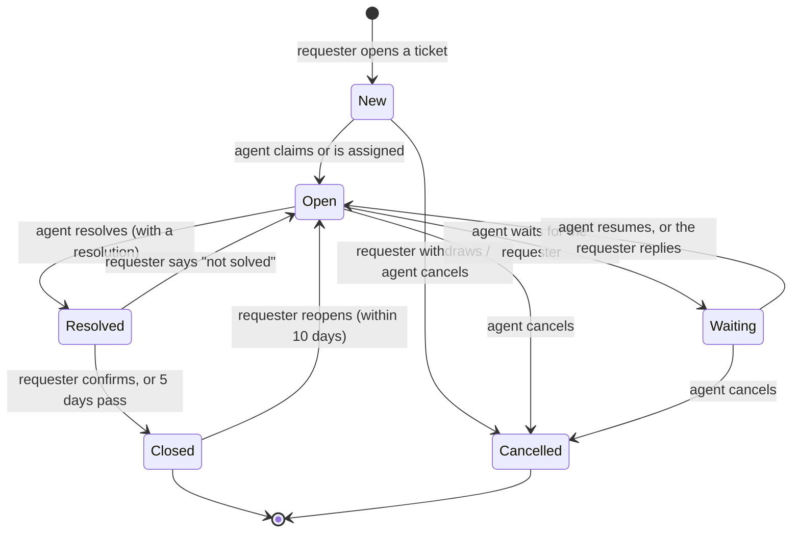

# Helpdesk (ABP Framework)

[](https://github.com/KimThanhTran/helpdesk-abp/actions/workflows/ci.yml)


A support-desk back end built on the [ABP Framework](https://abp.io): people raise tickets, agents pick them up from a queue and work them to a close, and managers can follow everything in a Google Sheet. It is a REST API with a PostgreSQL database; a web front end is planned but not built yet (see [Limitations](#limitations-and-next-steps)).

The focus of the project is getting the hard parts right and proving it: the ticket life cycle, who may do what, the privacy of internal notes, SLA targets in business hours, safe ticket numbering under load, and an export to Google Sheets that cannot leak or corrupt data.

## What it does

- **Tickets** with a six-status life cycle, comments and an append-only history. Every ticket gets a number like `HD-2026-000123`, restarting each year and never reused.
- **Three roles.** *Requesters* raise tickets and follow their own. *Agents* work a queue, assign, change priority and write internal notes. *Admins* manage categories and see everything.
- **Internal notes** that the requester can never see, on any endpoint.
- **SLA targets in business hours** (first response and resolution, by priority), with a configurable calendar, time zone and holidays, and "overdue" flags.
- **Categories as data.** Adding "Legal" or "Facilities" needs no deployment and no change to the ticket rules.
- **Reopen and auto-close.** A requester confirms or rejects a resolution, can reopen a closed ticket for 10 days, and a resolved ticket nobody answers closes itself after 5 days.
- **Reports:** counts by status, priority and category, average time to resolve, and what is overdue right now.
- **Google Sheets export** through a Google Apps Script, signed and privacy-first. See [integrations/google-sheets](integrations/google-sheets/README.md).

## Ticket life cycle



Anything not in the diagram is refused with HTTP 409. The "who and when" rules live in one table, `TicketPolicy`, which the API uses both to refuse a call and to tell the client which buttons to show (`actions` on every ticket). A test checks that table against the real aggregate for every status and action (72 combinations, both ways), so the two cannot drift apart.

## Who may do what

| | Requester (own ticket) | Agent | Admin |
| --- | :-: | :-: | :-: |
| Open a ticket, comment publicly | yes | yes | yes |
| Write an internal note | no | yes | yes |
| Claim, assign, change priority, wait, resume, resolve | no | yes | yes |
| Confirm, reject, reopen | yes | no | no |
| Cancel | only while still new | until resolved | until resolved |
| See the agent queue and reports | no | yes | yes |
| Manage categories | no | no | yes |

An agent who also raised a ticket gets both sets of rights on it. Errors are specific: **403** when the role cannot do it, **404** when the ticket is not yours (so ids cannot be probed), **409** when its status forbids it, **400** for a missing reason or a validation problem, **401** without a token.

## Quick start

You need Docker. Nothing else.

```bash
git clone https://github.com/KimThanhTran/helpdesk-abp.git
cd helpdesk-abp
docker compose up --build        # PostgreSQL + migrations + demo data + API on http://localhost:8080
```

The demo data has four users, all with the password `1q2w3E*` (**demo only**): `alice` and `bob` (requesters), `agent1` (agent) and `admin`.

### Try it in Swagger

1. Open <http://localhost:8080/swagger> and click **Authorize**.
2. Enter a user name (for example `alice`) and the password `1q2w3E*`. `client_id` is already filled in with `Helpdesk_Demo`. Click **Authorize**, then **Close**.
3. Call `GET /api/app/category` to get a category id, then `POST /api/app/ticket` to open a ticket.
4. To see the other side, click **Authorize → Logout** and sign in as `agent1`: `GET /api/app/ticket/queue?Scope=1` shows the ticket, and `POST /api/app/ticket/{id}/claim` takes it. Signed in as `bob`, the same ticket answers 404.

The same flow from a shell:

```bash
# sign in as alice (password flow, demo client)
TOKEN=$(curl -s -X POST http://localhost:8080/connect/token \
  -d "grant_type=password&client_id=Helpdesk_Demo&username=alice&password=1q2w3E*&scope=Helpdesk" | jq -r .access_token)

CATEGORY=$(curl -s -H "Authorization: Bearer $TOKEN" http://localhost:8080/api/app/category | jq -r '.items[0].id')

curl -s -X POST http://localhost:8080/api/app/ticket \
  -H "Authorization: Bearer $TOKEN" -H "Content-Type: application/json" \
  -d "{\"categoryId\":\"$CATEGORY\",\"title\":\"Printer jams\",\"description\":\"Page two always jams\"}" | jq '{code, status, actions}'
```

To see the Google Sheets export working without a Google account:

```bash
SHEETS_WEBHOOK_URL=http://sheets-stub:8787/exec SHEETS_SECRET=dev-secret \
SHEETS_INCLUDE_TITLE=true SHEETS_INCLUDE_PEOPLE=true \
docker compose --profile sheets-demo up --build
python scripts/smoke_test.py http://localhost:8080      # needs Python 3; add SHEETS_DUMP_URL=http://localhost:8787/dump to check the sheet too
curl http://localhost:8787/dump                          # what the fake spreadsheet contains
```

### Develop without Docker for the app

```bash
cd backend
docker run -d --name hd-pg -e POSTGRES_PASSWORD=pw -e POSTGRES_DB=Helpdesk -p 5432:5432 postgres:16-alpine
export ConnectionStrings__Default="Host=localhost;Database=Helpdesk;User ID=postgres;Password=pw" Helpdesk__SeedDemoData=true
dotnet run --project src/Helpdesk.DbMigrator          # create the schema and the demo data
dotnet run --project src/Helpdesk.HttpApi.Host        # the API (see launchSettings for the port)
dotnet test Helpdesk.slnx                             # needs Docker for the PostgreSQL tests
```

## API

Routes follow the ABP convention. Every call needs a bearer token.

| Method | Route | Who | What |
| --- | --- | --- | --- |
| POST | `/api/app/ticket` | requester | open a ticket |
| GET | `/api/app/ticket/{id}` | requester (own) / agent | one ticket with comments, history and `actions` |
| GET | `/api/app/ticket/my-list` | any | tickets I opened (filter, sort, page) |
| GET | `/api/app/ticket/queue?Scope=1\|2\|3` | agent | 1 = unassigned, 2 = mine, 3 = all |
| GET | `/api/app/ticket/assignable-agents` | agent | people a ticket can be assigned to |
| POST | `/api/app/ticket/{id}/claim` `assign` `priority`… | agent | take it, assign it, change priority |
| POST | `/api/app/ticket/{id}/wait` `resume` `resolve` | agent | pause, continue, finish |
| POST | `/api/app/ticket/{id}/confirm` `reject` `reopen` | requester | accept, refuse, bring back |
| POST | `/api/app/ticket/{id}/cancel` | requester / agent | withdraw |
| POST | `/api/app/ticket/{id}/comment` | participants | public comment or internal note |
| GET / POST / PUT / DELETE | `/api/app/category` … | admin to change | categories (+ `set-active`) |
| GET | `/api/app/ticket-report/summary` | agent | counts, overdue, average resolution time |

## Design decisions

| Decision | Why |
| --- | --- |
| **Status rules in the aggregate, role rules in one policy table** | A rule written once cannot disagree with itself. The controller layer has no `if (status == ...)`, and a test compares policy and aggregate exhaustively. |
| **Internal notes are removed when the response is built**, not hidden by the client | No endpoint that returns a ticket can leak them. Tests serialise the whole response and search it for the secret text. |
| **Someone else's ticket is a 404, not a 403** | A 403 would confirm that the id exists. |
| **Ticket numbers from one atomic SQL statement** (`INSERT … ON CONFLICT DO UPDATE … RETURNING`) | No race, no gaps from a lost transaction. Proven on a real PostgreSQL with 50 simultaneous requests. |
| **Tickets reference categories and people by id, with no navigation property** | With a navigation, ABP updates the category's concurrency stamp on every new ticket and simultaneous creation fails. |
| **SLA is computed in business hours** with a calendar (hours, days, holidays, time zone) | "8 hours" means 8 working hours, not a night and a weekend. It is a small, pure class with its own tests. |
| **The Sheets export sends a minimum, signed, after the commit** | See [the integration README](integrations/google-sheets/README.md). Two bugs found only by running the real stack are described below. |
| **Soft delete, append-only history and comments** | They are the record of who said and did what. |
| **Enums are stored and sent as numbers** | Renaming a value can never change the meaning of stored data. |

### Two bugs the unit tests could not find

Running the whole stack against PostgreSQL, with real HTTP and real tokens, found two defects that every test above missed. Both are now covered by the end-to-end script:

1. **The export read the ticket before the change was committed.** ABP runs local event handlers inside the caller's transaction, so the handler saw the previous state (and nothing at all for a new ticket). The export is now deferred until after the commit.
2. **The deferred work used a disposed DI scope.** ABP disposes the handler's scope as soon as the handler returns. The deferred callback now creates its own scope.

## Tests

| Layer | Tests | What it proves |
| --- | ---: | --- |
| Domain (xUnit, no database) | 217 | the state machine guard by guard, the policy table against the aggregate for all 72 status × action pairs, the SLA calendar (weekends, holidays, time zones) |
| Application (73 against SQLite, 25 plain) | 98 | real seeded users and real permission checks: workflow, 403/404/409, internal-note privacy, lists and paging, categories, reports, roles, the export, and rules about the shape of the code (every service needs a permission) |
| PostgreSQL (Testcontainers) | 4 | the migrations apply, the model matches them, ticket numbers survive 50 simultaneous requests |
| Google Apps Script (Node, fakes of Google) | 23 | signatures, replay, tampering, idempotency, ordering |
| End to end (`scripts/smoke_test.py`) | 49 checks | the whole Docker stack over HTTP, including the contents of the sheet |

The tests were also checked the other way round: deliberately breaking a guard, the internal-note filter, the "not your ticket" check and the replay protection each turned tests red.

CI runs all of it on every push (`.github/workflows/ci.yml`).

## Project structure

```
backend/
├── src/
│   ├── Helpdesk.Domain.Shared        enums, constants, error codes, permission names, texts
│   ├── Helpdesk.Domain               Ticket, Category, TicketPolicy, TicketManager, SLA calendar, data seed
│   ├── Helpdesk.Application.Contracts DTOs and service interfaces
│   ├── Helpdesk.Application          ticket, category and report services, the Sheets export, auto-close worker
│   ├── Helpdesk.EntityFrameworkCore  mappings, migrations, the ticket-number generator
│   ├── Helpdesk.HttpApi.Host         the API (auth, error mapping, Swagger)
│   └── Helpdesk.DbMigrator           applies migrations and seeds data
├── test/                             Domain.Tests, Application.Tests, EntityFrameworkCore.Tests, PostgresTests
└── Dockerfile                        targets: api, migrator
integrations/google-sheets/           Code.gs (Apps Script), its tests, a local stand-in server
scripts/smoke_test.py                 end-to-end check over HTTP
docker-compose.yml
```

## Limitations and next steps

- **No front end yet.** This is the API. A React interface that uses it is the next step.
- **The SLA clock does not pause while a ticket is waiting.** A waiting ticket is simply not counted as overdue. Pausing and extending the due date is the natural next feature.
- **No attachments and no e-mail or in-app notifications.**
- **The Sheets export is best effort.** There is no outbox and no retry: a delivery lost to a network failure is logged, and the next change to that ticket repairs the row.
- **The auto-close worker runs in every API instance.** With several instances, register it in one or guard it with a distributed lock.
- **Demo-grade deployment.** The compose file uses development signing keys (tokens stop working after a restart), plain HTTP on localhost, and published demo passwords. Production needs a real certificate, HTTPS, secrets from a vault and `SeedDemoData=false`. Swagger is on in every environment.
- **Not covered by tests:** HTTP status mapping is checked only by the end-to-end script, not by unit tests; load and security testing have not been done.
- The user interface language is English only, and there is no multi-tenancy (switched off).

## Credits

Built on the [ABP Framework](https://abp.io) (open source, LGPL-3.0) with ASP.NET Core, Entity Framework Core and PostgreSQL. No licence file is included for this repository's own code.
