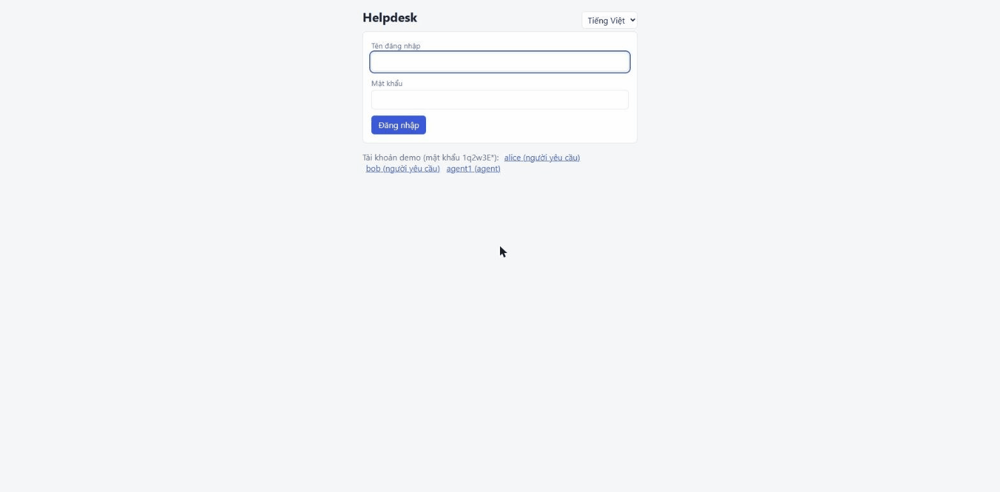
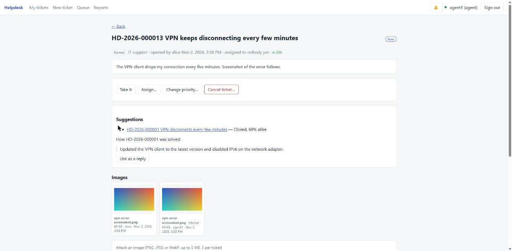
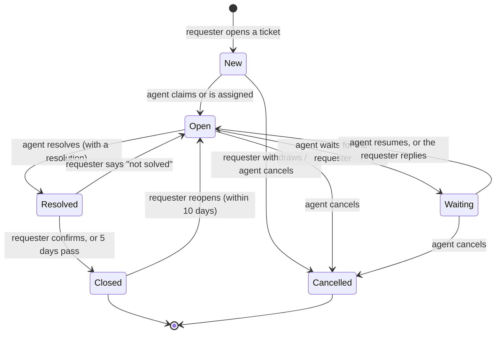

# Helpdesk (ABP Framework)

[](https://github.com/KimThanhTran/helpdesk-abp/actions/workflows/ci.yml)


A support desk built on the [ABP Framework](https://abp.io): people raise tickets, agents pick them up from a queue and work them to a close, and managers can follow everything in a Google Sheet. It is a REST API with a PostgreSQL database, a React web UI with live notifications, and a Flutter app for requesters.





The focus of the project is getting the hard parts right and proving it: the ticket life cycle, who may do what, the privacy of internal notes, SLA targets in business hours, safe ticket numbering under load, and an export to Google Sheets that cannot leak or corrupt data.

## What it does

- **Tickets** with a six-status life cycle, comments and an append-only history. Every ticket gets a number like `HD-2026-000123`, restarting each year and never reused.
- **Three roles.** *Requesters* raise tickets and follow their own. *Agents* work a queue, assign, change priority and write internal notes. *Admins* manage categories and see everything.
- **Internal notes** that the requester can never see, on any endpoint.
- **SLA targets in business hours** (first response and resolution, by priority), with a configurable calendar, time zone and holidays, and "overdue" flags.
- **Categories as data.** Adding "Legal" or "Facilities" needs no deployment and no change to the ticket rules.
- **Reopen and auto-close.** A requester confirms or rejects a resolution, can reopen a closed ticket for 10 days, and a resolved ticket nobody answers closes itself after 5 days.
- **The SLA clock stops while a ticket waits for the requester.** The working hours spent waiting are added to both targets when it resumes, by an agent or by the requester's reply.
- **Live notifications over SignalR.** Agents hear about every change, everyone else about the tickets they raised. A notification names the ticket and the change, never its description or a comment.
- **Triage suggestions** from the tickets that already exist (TF-IDF, no external AI service): the likely category while typing, similar tickets, a warning for a probable duplicate and how a similar ticket was solved. Other people's tickets are shown to agents only.
- **A React web UI** ([frontend](frontend)) and **a Flutter app** for requesters ([mobile](mobile/README.md)). Both show exactly the buttons the API lists in `actions`.
- **Images on tickets.** PNG, JPEG or WebP, up to 5 MB each and five per ticket, on the web UI (choose files or paste a screenshot with Ctrl+V, on the New ticket form or later on the ticket) and in the Flutter app (after the ticket exists). The type is decided from the file's bytes, never from its name, and a requester can neither see nor learn about an agent's internal images.
- **Excel export.** An agent downloads the queue (with the filters on screen) or the report as a real `.xlsx` file: frozen bold header, filters, real dates.
- **Light and dark.** A sun/moon button next to the language switch; without a choice it follows the system, and the choice is remembered (web) or kept for the session (Flutter).
- **English and Vietnamese.** A language switch in the web UI header and the Flutter app bar; the choice is remembered (web) or follows the phone (Flutter). The API also answers its own messages in the language it is asked for with `Accept-Language: vi` (or `?culture=vi`), and the UI sends it for you.
- **Reports:** counts by status, priority and category, average time to resolve, and what is overdue right now.
- **Google Sheets export** through a Google Apps Script, signed and privacy-first. See [integrations/google-sheets](integrations/google-sheets/README.md).

## Ticket life cycle



Anything not in the diagram is refused with HTTP 409. The "who and when" rules live in one table, `TicketPolicy`, which the API uses both to refuse a call and to tell the client which buttons to show (`actions` on every ticket). A test checks that table against the real aggregate for every status and action (72 combinations, both ways), so the two cannot drift apart.

## Who may do what

| | Requester (own ticket) | Agent | Admin |
| --- | :-: | :-: | :-: |
| Open a ticket, comment publicly | yes | yes | yes |
| Write an internal note | no | yes | yes |
| Claim, assign, change priority, wait, resume, resolve | no | yes | yes |
| Confirm, reject, reopen | yes | no | no |
| Cancel | only while still new | until resolved | until resolved |
| Attach an image | like commenting | yes (also internal) | yes |
| See the agent queue and reports | no | yes | yes |
| Export to Excel | no | yes | yes |
| Manage categories | no | no | yes |

An agent who also raised a ticket gets both sets of rights on it. Errors are specific: **403** when the role cannot do it, **404** when the ticket is not yours (so ids cannot be probed), **409** when its status forbids it, **400** for a missing reason or a validation problem, **401** without a token.

## Quick start

You need Docker. Nothing else.

```bash
git clone https://github.com/KimThanhTran/helpdesk-abp.git
cd helpdesk-abp
docker compose up --build        # PostgreSQL + migrations + demo data + API on http://localhost:8080 + web UI on http://localhost:3000
```

Open <http://localhost:3000>, sign in as `alice` (requester) in one tab and `agent1` (agent) in another, and watch one react to the other: the notification bell, the SLA that pauses when the agent waits for the requester, the suggestions on the agent's ticket page. The Flutter app is described in [mobile/README.md](mobile/README.md). To put the demo online see [docs/deploy.md](docs/deploy.md).

The demo data has four users, all with the password `1q2w3E*` (**demo only**): `alice` and `bob` (requesters), `agent1` (agent) and `admin`, plus a dozen past tickets so the suggestions have history to learn from.

### Try it in Swagger

1. Open <http://localhost:8080/swagger> and click **Authorize**.
2. Enter a user name (for example `alice`) and the password `1q2w3E*`. `client_id` is already filled in with `Helpdesk_Demo`. Click **Authorize**, then **Close**.
3. Call `GET /api/app/category` to get a category id, then `POST /api/app/ticket` to open a ticket.
4. To see the other side, click **Authorize → Logout** and sign in as `agent1`: `GET /api/app/ticket/queue?Scope=1` shows the ticket, and `POST /api/app/ticket/{id}/claim` takes it. Signed in as `bob`, the same ticket answers 404.

The same flow from a shell:

```bash
# sign in as alice (password flow, demo client)
TOKEN=$(curl -s -X POST http://localhost:8080/connect/token \
  -d "grant_type=password&client_id=Helpdesk_Demo&username=alice&password=1q2w3E*&scope=Helpdesk" | jq -r .access_token)

CATEGORY=$(curl -s -H "Authorization: Bearer $TOKEN" http://localhost:8080/api/app/category | jq -r '.items[0].id')

curl -s -X POST http://localhost:8080/api/app/ticket \
  -H "Authorization: Bearer $TOKEN" -H "Content-Type: application/json" \
  -d "{\"categoryId\":\"$CATEGORY\",\"title\":\"Printer jams\",\"description\":\"Page two always jams\"}" | jq '{code, status, actions}'
```

To see the Google Sheets export working without a Google account:

```bash
SHEETS_WEBHOOK_URL=http://sheets-stub:8787/exec SHEETS_SECRET=dev-secret \
SHEETS_INCLUDE_TITLE=true SHEETS_INCLUDE_PEOPLE=true \
docker compose --profile sheets-demo up --build
python scripts/smoke_test.py http://localhost:8080      # needs Python 3; add SHEETS_DUMP_URL=http://localhost:8787/dump to check the sheet too
curl http://localhost:8787/dump                          # what the fake spreadsheet contains
```

### Develop without Docker for the app

```bash
cd backend
docker run -d --name hd-pg -e POSTGRES_PASSWORD=pw -e POSTGRES_DB=Helpdesk -p 5432:5432 postgres:16-alpine
export ConnectionStrings__Default="Host=localhost;Database=Helpdesk;User ID=postgres;Password=pw" Helpdesk__SeedDemoData=true
dotnet run --project src/Helpdesk.DbMigrator          # create the schema and the demo data
dotnet run --project src/Helpdesk.HttpApi.Host        # the API (see launchSettings for the port)
dotnet test Helpdesk.slnx                             # needs Docker for the PostgreSQL tests

cd ../frontend && npm ci
API_TARGET=http://localhost:5080 npm run dev          # the web UI on :5173, forwarding /api, /connect and /signalr-hubs to the API
npm test                                              # 35 tests
```

## API

Routes follow the ABP convention. Every call needs a bearer token.

| Method | Route | Who | What |
| --- | --- | --- | --- |
| POST | `/api/app/ticket` | requester | open a ticket |
| GET | `/api/app/ticket/{id}` | requester (own) / agent | one ticket with comments, history and `actions` |
| GET | `/api/app/ticket/my-list` | any | tickets I opened (filter, sort, page) |
| GET | `/api/app/ticket/queue?Scope=1\|2\|3` | agent | 1 = unassigned, 2 = mine, 3 = all |
| GET | `/api/app/ticket/assignable-agents` | agent | people a ticket can be assigned to |
| POST | `/api/app/ticket/{id}/claim` `assign` `priority`… | agent | take it, assign it, change priority |
| POST | `/api/app/ticket/{id}/wait` `resume` `resolve` | agent | pause, continue, finish |
| POST | `/api/app/ticket/{id}/confirm` `reject` `reopen` | requester | accept, refuse, bring back |
| POST | `/api/app/ticket/{id}/cancel` | requester / agent | withdraw |
| POST | `/api/app/ticket/{id}/comment` | participants | public comment or internal note |
| GET / POST / PUT / DELETE | `/api/app/category` … | admin to change | categories (+ `set-active`) |
| GET | `/api/app/ticket-report/summary` | agent | counts, overdue, average resolution time |
| GET | `/api/app/ticket-triage/suggestion` | any | category suggestions; similar tickets and a suggested reply for agents |
| GET | `/api/app/ticket-attachment?ticketId=` | participants | the images of a ticket (without their bytes) |
| POST | `/api/app/ticket-attachment/upload/{ticketId}?visibility=1\|2` | participants | add an image: `multipart/form-data`, part `file`; 415 not an image, 413 over 5 MB, 409 over five |
| GET | `/api/app/ticket-attachment/{id}/content` | participants | the image itself (404 for internal ones if you are not an agent) |
| GET | `/api/app/ticket-export/tickets` | agent | `.xlsx` of the tickets that match the queue filters (up to 5,000 rows) |
| GET | `/api/app/ticket-export/summary` | agent | `.xlsx` of the report, one sheet each for totals, status, priority, category |
| any | `Accept-Language: en\|vi` | any | the language of error messages and validation texts; anything else answers in English |
| WS | `/signalr-hubs/tickets` | any | live `ticketChanged` notifications (token as `access_token` query string) |

## Design decisions

| Decision | Why |
| --- | --- |
| **Status rules in the aggregate, role rules in one policy table** | A rule written once cannot disagree with itself. The controller layer has no `if (status == ...)`, and a test compares policy and aggregate exhaustively. |
| **Internal notes are removed when the response is built**, not hidden by the client | No endpoint that returns a ticket can leak them. Tests serialise the whole response and search it for the secret text. |
| **Someone else's ticket is a 404, not a 403** | A 403 would confirm that the id exists. |
| **Ticket numbers from one atomic SQL statement** (`INSERT … ON CONFLICT DO UPDATE … RETURNING`) | No race, no gaps from a lost transaction. Proven on a real PostgreSQL with 50 simultaneous requests. |
| **Tickets reference categories and people by id, with no navigation property** | With a navigation, ABP updates the category's concurrency stamp on every new ticket and simultaneous creation fails. |
| **SLA is computed in business hours** with a calendar (hours, days, holidays, time zone) | "8 hours" means 8 working hours, not a night and a weekend. It is a small, pure class with its own tests. |
| **The Sheets export sends a minimum, signed, after the commit** | See [the integration README](integrations/google-sheets/README.md). Two bugs found only by running the real stack are described below. |
| **Soft delete, append-only history and comments** | They are the record of who said and did what. |
| **Images are accepted by their first bytes, not their name or declared type** | A script renamed to `photo.png` is refused (415). The stored name gets the extension of the real type, folders and control characters are stripped, and downloads carry `nosniff` and `Content-Disposition: attachment`. |
| **Images are separate from the ticket and live in PostgreSQL** | Loading a ticket never loads bytes, and lists are projections without them. One database to back up and no file-permission questions; the cost is a bigger database (see the limitations). |
| **Excel files are written without a library** | The format is a zip of a few XML files. Text is always a string cell, never a formula, so a title like `=HYPERLINK(...)` stays text; control characters are dropped and long cells cut to Excel's limit. Checked by opening the real output with openpyxl. |
| **Texts live in one dictionary per language, and a test fails if they drift** | Every UI text and every server error code must exist in English and Vietnamese with the same `{placeholders}`; a missing or untranslated one turns the build red instead of showing English by accident. |
| **Notifications say what changed; the client words it** | A SignalR message carries the kind, status and priority, not a finished sentence, so each person reads it in the language they have chosen now. |
| **Enums are stored and sent as numbers** | Renaming a value can never change the meaning of stored data. |

### Two bugs the unit tests could not find

Running the whole stack against PostgreSQL, with real HTTP and real tokens, found two defects that every test above missed. Both are now covered by the end-to-end script:

1. **The export read the ticket before the change was committed.** ABP runs local event handlers inside the caller's transaction, so the handler saw the previous state (and nothing at all for a new ticket). The export is now deferred until after the commit.
2. **The deferred work used a disposed DI scope.** ABP disposes the handler's scope as soon as the handler returns. The deferred callback now creates its own scope.

## Tests

| Layer | Tests | What it proves |
| --- | ---: | --- |
| Domain (xUnit, no database) | 275 | the state machine guard by guard, the policy table against the aggregate for all 72 status × action pairs, the SLA calendar (weekends, holidays, time zones, pauses), the triage index, which bytes count as an image and which names are safe, and that English and Vietnamese have the same error texts |
| Application (123 against SQLite, 38 plain) | 161 | real seeded users and real permission checks: workflow, 403/404/409, internal-note and internal-image privacy, SLA pause, notifications, triage, attachments, Excel export, the demo data, lists and paging, categories, reports, roles, the Sheets export, and rules about the shape of the code (every service needs a permission); the Excel writer is checked by reading the files back |
| PostgreSQL (Testcontainers) | 4 | the migrations apply, the model matches them, ticket numbers survive 50 simultaneous requests |
| Google Apps Script (Node, fakes of Google) | 23 | signatures, replay, tampering, idempotency, ordering |
| Web UI (Vitest) | 112 | the API client's errors, routes, uploads and downloads, SLA wording, notifications, the ticket page's buttons, attaching images (what is refused before upload, creating a ticket with images and what happens when one fails), pasting screenshots, Excel export buttons, the language switch, the light/dark button and that both dictionaries match |
| Flutter (`flutter test`) | 35 | the API client, the sign-in, open and confirm flow, attaching images, switching language and light/dark against a fake server |
| End to end (`scripts/smoke_test.py`) | 70 checks | the whole Docker stack over HTTP, including real multipart uploads, a 5 MB limit, opening the downloaded `.xlsx`, and an error answered in Vietnamese (more checks when the Sheets stand-in is attached) |

The tests were also checked the other way round: deliberately breaking a guard, the internal-note filter, the "not your ticket" check and the replay protection each turned tests red.

The web UI and the Flutter app were also driven by hand in Chrome against the real stack, which found two bugs no test had. The second one: demo tickets seeded with their deadlines in the year 0001 (a priority change measured the SLA from a creation time that did not exist yet), which only showed when the Excel export refused to write such a date. The seeder now saves first, the manager refuses to measure a deadline from an unsaved ticket, and the export leaves impossible dates empty. The first: a browser that holds an `XSRF-TOKEN` cookie from another ABP app on `localhost` got an empty 400 on every POST, because ABP's automatic anti-forgery check ran on a bearer-token API. The check is now off (nothing here is authenticated by cookie) and the smoke test covers it.

CI runs the backend, the Apps Script, the web UI, the Flutter app and the end-to-end script on every push (`.github/workflows/ci.yml`).

## Project structure

```
backend/
├── src/
│   ├── Helpdesk.Domain.Shared        enums, constants, error codes, permission names, texts
│   ├── Helpdesk.Domain               Ticket, Category, TicketPolicy, TicketManager, SLA calendar, data seed
│   ├── Helpdesk.Application.Contracts DTOs and service interfaces
│   ├── Helpdesk.Application          ticket, category, report, triage, attachment and Excel export services, notifications, the Sheets export, auto-close worker
│   ├── Helpdesk.EntityFrameworkCore  mappings, migrations, the ticket-number generator
│   ├── Helpdesk.HttpApi.Host         the API (auth, error mapping, Swagger, the SignalR hub)
│   └── Helpdesk.DbMigrator           applies migrations and seeds data
├── test/                             Domain.Tests, Application.Tests, EntityFrameworkCore.Tests, PostgresTests
└── Dockerfile                        targets: api, migrator
frontend/                             React UI (Vite), Dockerfile + nginx that serves it and forwards the API
mobile/                               Flutter app for requesters
integrations/google-sheets/           Code.gs (Apps Script), its tests, a local stand-in server
docs/deploy.md, render.yaml           putting the demo online (Render + Neon + GitHub Pages)
scripts/smoke_test.py                 end-to-end check over HTTP
docker-compose.yml
```

## Limitations and next steps

- **The live demo needs your own accounts.** Everything for it is in the repository ([docs/deploy.md](docs/deploy.md), `render.yaml`, the Pages workflow), but it has not been deployed: Render, Neon and GitHub Pages sign-ups cannot be done for you. A free API sleeps after 15 minutes idle and takes about a minute to wake.
- **The web UI keeps its token in `sessionStorage`**, which any script on the page can read; a production setup would use an HttpOnly cookie. The Flutter app keeps it in memory only, has no live updates and no agent screens, and its Android project has not been built on a device.
- **The triage is a keyword index, not a language model.** It rebuilds from the 2,000 newest tickets on every call and knows nothing about synonyms; it is useful and easy to explain, not accurate.
- **Notifications are not stored.** A person who is offline when a change happens never hears about it, and the bell forgets on reload. There is no e-mail or push.
- **Images only, and stored in PostgreSQL.** No PDFs or documents. Five 5 MB images per ticket is at most 25 MB a ticket in the database; move them to object storage (S3, Azure Blob) before volume matters. The server checks the first bytes, not the whole image: it does not decode, re-encode or strip metadata, so a camera photo keeps its GPS tags and a file with a PNG header and garbage after it is accepted.
- **Excel export is a snapshot in UTC.** At most 5,000 rows, built in memory, with titles and names (the agent asked for them; the Google Sheets export leaves them out by default). Opened with openpyxl, not with Excel itself.
- **The Sheets export is best effort.** There is no outbox and no retry: a delivery lost to a network failure is logged, and the next change to that ticket repairs the row. The Apps Script itself has only been run against fakes of Google, not against a real spreadsheet.
- **The auto-close worker runs in every API instance.** With several instances, register it in one or guard it with a distributed lock. SignalR would also need a backplane to work across instances.
- **Demo-grade deployment.** The compose file uses development signing keys (tokens stop working after a restart), plain HTTP on localhost, and published demo passwords. Production needs a real certificate, HTTPS, secrets from a vault and `SeedDemoData=false`. Swagger is on in every environment.
- **Not covered by tests:** HTTP status mapping is checked only by the end-to-end script; load and security testing have not been done. The build reports a known vulnerability in a transitive package (`System.Security.Cryptography.Xml`) that comes with ABP and has not been upgraded here.
- **Only English and Vietnamese.** The Vietnamese wording was written without a native review: read it and correct what sounds wrong (it is in `frontend/src/locales.js`, `mobile/lib/strings.dart` and `backend/src/Helpdesk.Domain.Shared/Localization/Helpdesk/vi.json`). Data is not translated: category names, ticket titles, comments and the demo tickets stay as written, enum words that the server puts into an error (for example the status in "the ticket is Closed and cannot be changed") stay English, the login error uses the app's own wording because the sign-in server's is English only, and dates use the chosen language's format but the browser's time zone. Flutter does not remember the chosen language between launches.
- There is no multi-tenancy (switched off).

## Credits

Built on the [ABP Framework](https://abp.io) (open source, LGPL-3.0) with ASP.NET Core, Entity Framework Core and PostgreSQL. No licence file is included for this repository's own code.
